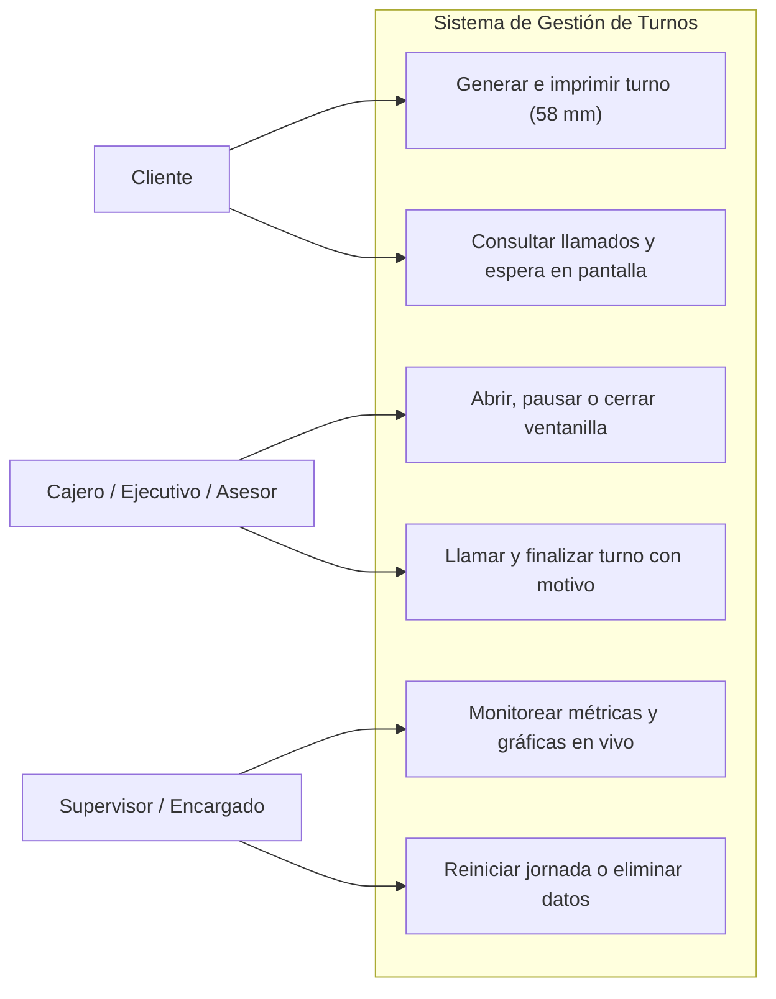
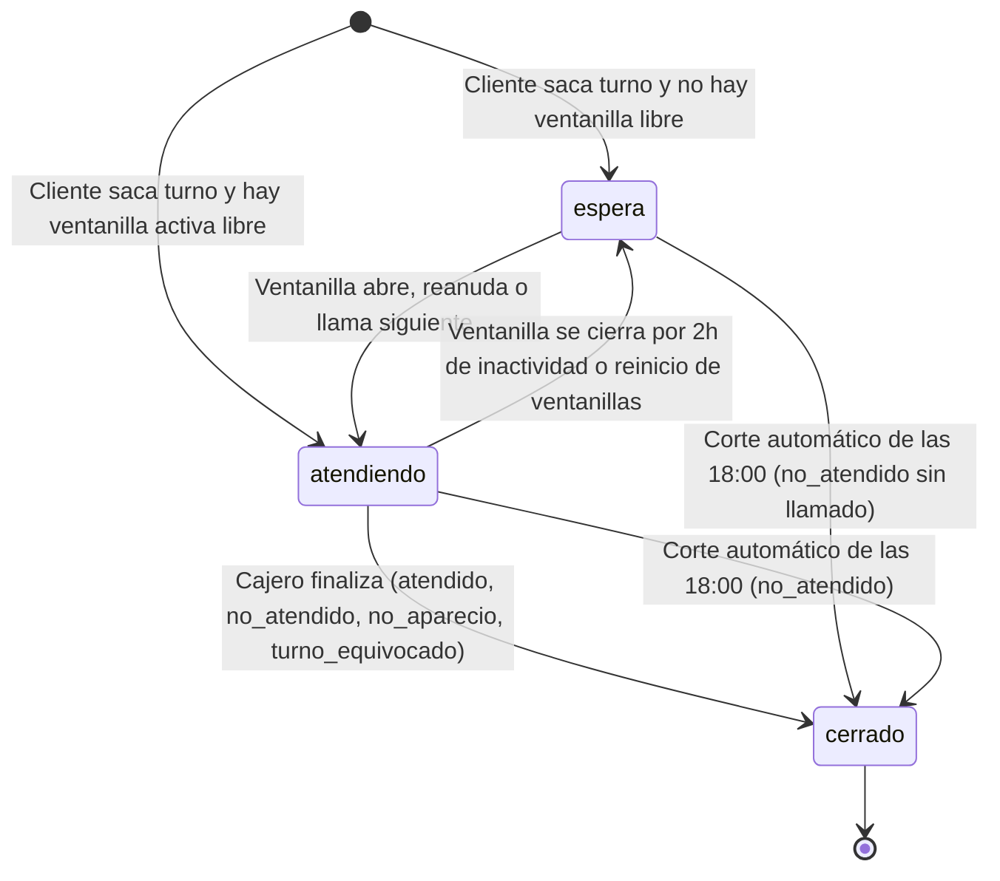
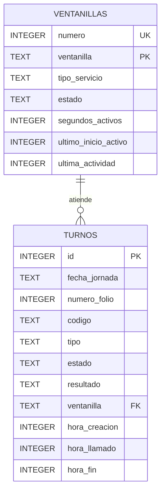

# **Definición de Proyecto: Sistema de Gestión de Turnos**

# **1. Definición del proyecto**

El **Sistema de Gestión de Turnos** es una aplicación web ligera pensada para organizar la fila de clientes dentro de una sucursal o comercio usando el orden de llegada **FIFO** (*primero en entrar, primero en salir*). El sistema conecta cuatro pantallas web independientes —kiosco para sacar turno, pantalla pública para la sala de espera, panel de ventanilla para los empleados y dashboard de estadísticas— hechas con HTML5, CSS3 y JavaScript puro, conectadas a un servidor local en Node.js con Express y base de datos SQLite.

# **2. Descripción del proyecto**

* **Problemática actual:** Cuando las filas se manejan sin sistema se hacen bolas entre clientes de distintos trámites, nadie sabe cuánto tiempo va a esperar, unas ventanillas trabajan más que otras y al final del día el encargado no tiene datos reales de cuántos clientes se atendieron ni cuánto tardaron.
* **Solución propuesta:** Un servidor central (`server.js`) que corre en la red local del negocio con una base de datos SQLite (`turnos.db`) y avisos en tiempo real por Server-Sent Events (SSE). El sistema separa los turnos por tipo de servicio, avisa en la pantalla y con sonido cuando toca pasar a ventanilla y guarda los tiempos para consultarlos al momento en el dashboard.

# **3. Justificación**

Hacer el sistema con tecnologías web directas (sin frameworks pesados ni servidores externos) permite que funcione rápido en cualquier computadora de la sucursal, incluso si se cae el internet, y que cualquier estudiante o técnico pueda darle mantenimiento.

## **Beneficios que se buscan**

* Ordenar la atención por orden de llegada y según el trámite que ocupa cada cliente (`Caja`, `Ejecutivo` o `Atención a Cliente`).
* Que todas las pantallas se actualicen solas en menos de un segundo sin tener que darle F5 al navegador.
* Que el personal abra su ventanilla con un clic sin perder tiempo con usuarios y contraseñas, pudiendo pausar su reloj cuando salga a descanso.
* Tener a la mano los promedios de espera, tiempos de atención y rendimiento por ventanilla durante todo el día.

## **Problemas que resuelve**

* Clientes formados en la fila equivocada o discusiones por quién llegó primero.
* Falta de registro cuando un cliente se va antes de que lo llamen o saca un turno que no era para su trámite.
* Desconocimiento de las horas con más gente y del tiempo real que cada ventanilla estuvo activa.

# **4. Objetivos**

* **Objetivo general:** Desarrollar un sistema web en tiempo real para administrar la fila de clientes, apoyar la atención en ventanillas y mostrar estadísticas diarias de operación en un comercio.
* **Objetivos específicos:**
  * Construir cuatro pantallas web con un mismo diseño oscuro azulado que se adapte bien a monitores horizontales, pantallas verticales y celulares.
  * Programar un servidor con Node.js, Express y SQLite para manejar los turnos de los tres servicios (`Caja`, `Ejecutivo` y `Atención a Cliente`).
  * Permitir que cada cajero o asesor elija su ventanilla, cierre el turno actual con un solo botón llamando al siguiente o ponga su ventanilla en pausa.
  * Calcular un tiempo estimado de espera realista tomando en cuenta el promedio de atención, la gente formada en la fila y las ventanillas activas.

# **5. Actores del sistema y casos de uso**

* **Cliente:** Llega al kiosco de entrada, elige el servicio que necesita, recoge su ticket impreso de 58 mm y espera a que su número salga en la pantalla de la sala.
* **Cajero / Ejecutivo / Asesor:** Elige su número de ventanilla al empezar, atiende al cliente asignado, registra cómo terminó el turno (`Atendido`, `No atendido`, `No apareció` o `Turno equivocado`) y maneja sus pausas o el cierre de su ventanilla.
* **Supervisor / Encargado:** Revisa en el dashboard los tiempos promedio, las gráficas del día y el rendimiento de las 7 ventanillas; también puede reiniciar la jornada o limpiar los datos de prueba.

# **6. Alcance y limitaciones**

| Aspecto | Qué incluye / Qué no incluye |
| :---- | :---- |
| **Alcance (lo que sí hace)** | Menú inicial en `/` para abrir cada vista; generación e impresión térmica de 58 mm para `Caja`, `Ejecutivo` y `Atención a Cliente` con folios del `01` al `99`; pantalla de sala de espera con timbre de aviso, hasta 7 ventanillas al mismo tiempo, fila de espera y tiempo estimado; panel de ventanilla con bloqueo si ya está en uso, recuperación tras recarga, 4 botones directos para cerrar y llamar al siguiente y opción de cerrar y pausar; actualización en vivo por SSE; corte automático a las 18:00 hrs; y dashboard con gráficas, tabla de ventanillas, botón para reiniciar jornada y botón para eliminar todos los datos. |
| **Limitaciones (lo que no hace)** | No maneja login con usuarios ni contraseñas; no tiene botón de rellamado de turnos; no cobra ni factura; no manda avisos por SMS ni WhatsApp; y está pensado para correr dentro de la red local (LAN) de una sola sucursal. |

# **7. Funcionalidades principales**

* **Menú de inicio (`/`):** Página sencilla para entrar con un clic a cualquiera de las 4 pantallas.
* **Kiosco de turnos (`kiosco.html`):** Tiene tres botones grandes para pantalla táctil (`Caja`, `Ejecutivo`, `Atención a Cliente`), genera el turno (`C-01`, `E-01`, `A-01`), imprime el ticket de 58 mm y a los 3 segundos regresa solo a la pantalla principal.
* **Pantalla pública (`pantalla.html`):** Muestra en grande los turnos que están pasando a ventanilla (resaltando el más reciente), los próximos 10 en fila, el tiempo estimado por servicio y suena un timbre cuando llaman a un turno nuevo.
* **Panel de ventanilla (`ventanilla.html`):** Deja elegir una de las 7 ventanillas (bloqueando las que ya están ocupadas), recuerda la ventanilla en el navegador por si se recarga la página, tiene los 4 botones grandes para terminar y llamar al que sigue, y el botón `"Cerrar y pausar..."` por si el empleado va a salir un momento.
* **Dashboard (`dashboard.html`):** Muestra los promedios de espera y atención, totales del día, gráfica de clientes por hora, gráfica y tabla de los 4 motivos de cierre, tabla de rendimiento por ventanilla con reloj en vivo y los botones `"Reiniciar jornada"` y `"Eliminar todos los datos"`.

# **8. Entregables del proyecto**

* **Documentación:** Especificación del sistema (`docs/SPEC.md`), guía de arquitectura (`AGENTS.md`) e instrucciones de instalación (`README.md`).
* **Código fuente:** Servidor backend en Node.js (`server.js`), base de datos SQLite (`turnos.db`), hoja de estilos compartida (`public/estilos.css`), funciones comunes de frontend (`public/comun.js`), las cuatro pantallas HTML y script de pruebas (`pruebas.js`).

---

# **9. Necesidades del negocio**

* Tener una pantalla en la entrada donde el cliente saque su ticket impreso sin depender de un guardia o recepcionista.
* Mostrar en un televisor los llamados y un tiempo estimado que sí suba cuando hay mucha fila y pocas cajas abiertas.
* No complicar a los cajeros con cuentas ni contraseñas: solo eligen en qué número de ventanilla están sentados y el sistema ya sabe qué servicio atienden.
* Hacer rápido el cambio entre un cliente y otro con un solo clic en el resultado del turno, pero dejando opción de pausar la ventanilla para no contar como tiempo trabajado las salidas a comer o al baño.
* Obligar a que todo turno cerrado quede registrado con uno de los 4 motivos (`Atendido`, `No atendido`, `No apareció`, `Turno equivocado`).
* Separar los turnos que el sistema cierra automáticamente a las 6:00 PM de los que cerró un cajero, para no alterar las estadísticas del personal.

# **10. Requisitos Funcionales (RF)**

## **Módulo Kiosco (`kiosco.html`)**

* **RF-01 Selección de trámite:** Mostrar tres botones grandes para `Caja`, `Ejecutivo` y `Atención a Cliente`.
* **RF-02 Folios cíclicos sin duplicados activos:** Asignar folios de dos dígitos del `01` al `99` por servicio (`C-01`..`C-99`, `E-01`..`E-99`, `A-01`..`A-99`). Al llegar al `99` en el mismo día, reinicia en `01` saltando cualquier número que todavía siga en espera o en atención.
* **RF-03 Impresión térmica:** Mostrar en pantalla el número asignado, mandar a imprimir el ticket de 58 mm con el código en grande y la fecha/hora (`DD/MM/YY HH:mm`) y regresar al inicio después de 3 segundos (configurado en la constante `SEGUNDOS_REGRESO`).

## **Módulo Pantalla Pública (`pantalla.html`)**

* **RF-04 Turnos llamados y sonido:** Mostrar el último turno llamado arriba en grande junto con los demás turnos en atención (hasta las 7 ventanillas) y reproducir un timbre de dos tonos en el navegador cuando entra un llamado nuevo.
* **RF-05 Fila de espera:** Mostrar hasta los próximos 10 turnos formados en orden de llegada e indicar cuántos más hay detrás.
* **RF-06 Tiempo estimado por servicio:** Mostrar el tiempo aproximado de espera de cada servicio; si hay menos de 3 turnos atendidos en el día muestra `"5 min"`, y cuando ya hay historial toma en cuenta tanto el promedio de los últimos 20 atendidos como la cantidad de personas en fila y ventanillas activas.

## **Módulo Panel de Ventanilla (`ventanilla.html`)**

* **RF-07 Selección y bloqueo de ventanilla:** Permitir abrir cualquiera de las 7 ventanillas si está cerrada; si otro equipo ya la tiene abierta o en pausa, responder error `409` y mostrar un aviso.
* **RF-08 Despacho automático en orden FIFO:** Asignar el turno más antiguo en espera al abrir la ventanilla, al volver de pausa o al terminar el turno anterior; y si llega un turno nuevo cuando hay ventanillas libres, asignarlo directo a la activa de menor número.
* **RF-09 Cierre directo en un clic:** Mostrar los 4 botones de resultado (`Atendido`, `No atendido`, `No apareció`, `Turno equivocado`) para cerrar el turno actual y llamar de inmediato al siguiente.
* **RF-10 Pausas y cierre de ventanilla:** Contar con el botón `"Cerrar y pausar..."` (que pide el motivo en una ventana emergente antes de pausar el reloj activo), además de `"Volver de pausa"` y `"Cerrar ventanilla"`.

## **Módulo Dashboard (`dashboard.html`)**

* **RF-11 Indicadores principales:** Mostrar promedio de espera, promedio de atención, turnos emitidos hoy, en espera/atendiendo y turnos cerrados.
* **RF-12 Gráficas con modo sin internet:** Mostrar la gráfica de clientes atendidos por hora y la de motivos de cierre con Chart.js; si no hay datos ocultar el lienzo vacío, y si no hay internet en la red local mostrar barras HTML con los mismos valores.
* **RF-13 Tabla de ventanillas, reinicio y borrado:** Mostrar por cada ventanilla su servicio, estado, turnos cerrados, atendidos y tiempo activo neto avanzando cada segundo, además de los botones `"Reiniciar jornada"` y `"Eliminar todos los datos"`.

## **Sincronización y Cierres Automáticos**

* **RF-14 Tiempo real por SSE:** Enviar cualquier cambio a todas las pantallas conectadas en menos de 1 segundo mediante `/api/eventos`.
* **RF-15 Corte diario a las 18:00 e inactividad de 2 horas:** Cerrar automáticamente a las 18:00 hrs las ventanillas abiertas y los turnos pendientes del día, y cerrar cualquier ventanilla que cumpla 2 horas sin actividad regresando su turno en atención a la fila de espera.

# **11. Requisitos No Funcionales (RNF)**

* **RNF-01 Tiempo de respuesta:** Actualización en vivo de las pantallas en menos de 1 segundo por SSE.
* **RNF-02 Atomicidad en base de datos:** Uso de transacciones `BEGIN IMMEDIATE ... COMMIT` en SQLite con modo `WAL` y `busy_timeout = 5000` para que ninguna operación quede guardada a medias si ocurre un error.
* **RNF-03 Recuperación de sesión:** Si el cajero recarga por accidente `ventanilla.html`, la página lee `localStorage`, consulta `/api/estado` y recupera su ventanilla y el turno que tenía en pantalla.
* **RNF-04 Diseño adaptable:** Tema oscuro azulado legible y responsivo que se acomoda sin barra de desplazamiento horizontal en monitores (`1366x768`), pantallas verticales (`768x1024`) y celulares (`320px` en adelante).
* **RNF-05 Funcionamiento local:** Todo el sistema corre dentro de la red LAN del negocio sin depender de servicios en la nube.

# **12. Entorno técnico y configuración en sucursal**

* **Servidor:** Node.js (`>= 22.13.0`) con `express` y el módulo nativo `node:sqlite`.
* **Navegador y periféricos recomendados:**
  * **Kiosco con impresora térmica Epson de 58 mm:** Configurar la impresora de 58 mm como predeterminada del sistema y abrir Google Chrome con los parámetros `--kiosk --kiosk-printing`. El parámetro `--kiosk-printing` es indispensable para que `window.print()` imprima el ticket directo sin abrir la ventana de vista previa que detendría el regreso automático de 3 segundos.
  * **Televisor de sala de espera:** Abrir Google Chrome hacia `/pantalla.html` con `--kiosk --autoplay-policy=no-user-gesture-required` para que el timbre sintetizado con Web Audio API suene desde el primer llamado sin pedir que alguien haga clic primero en la pantalla.

# **13. Diseño técnico y diagramas**

## **A. Ciclo de vida de un turno**

## **B. Modelo Entidad-Relación (`turnos.db`)**

* **Tabla `ventanillas`:** Guarda las 7 ventanillas fijas (`Ventanilla 1` a `4` de `caja`, `5` y `6` de `ejecutivo`, y `7` de `atencion`), su estado (`activo`, `pausa`, `cerrado`), los `segundos_activos` acumulados en el día y las marcas de tiempo `ultimo_inicio_activo` y `ultima_actividad` en milisegundos.
* **Tabla `turnos`:** Guarda cada turno con su `fecha_jornada` (`YYYY-MM-DD` en hora local de Culiacán/Mazatlán), `numero_folio` (`1` al `99`), `codigo` (`C-01`, `E-01`, `A-01`), `tipo`, `estado` (`espera`, `atendiendo`, `cerrado`), `resultado`, `ventanilla` y las horas `hora_creacion`, `hora_llamado` y `hora_fin` en milisegundos (`Date.now()`).

## **C. Fórmulas y reglas principales**

1. **Tiempo estimado de espera:**
   * Si el servicio tiene menos de 3 turnos cerrados como `atendido` en el día, devuelve `"5 min"`.
   * Cuando ya hay 3 o más atendidos, calcula el promedio de espera y de atención de los últimos 20 turnos atendidos de ese servicio. Si hay clientes formados en espera, estima `(personasEnFila / max(1, ventanillasActivas)) * promedioAtencion` (tomando el mayor entre ese cálculo y el promedio de espera reciente) para reflejar el tamaño real de la fila.
2. **Separación de cierres por corte de las 18:00:**
   * En el corte de las 18:00 hrs los turnos pendientes pasan a `estado = 'cerrado'` y `resultado = 'no_atendido'`.
   * En las métricas del dashboard, los turnos `no_atendido` que nunca fueron llamados (`hora_llamado IS NULL`) se contabilizan en `cerradosPorCorte` y no se mezclan en los porcentajes de motivos de los cajeros.
3. **Tiempo activo neto de ventanilla:**
   * Mientras la ventanilla está en `activo`, su tiempo es `segundos_activos + floor((ahora - ultimo_inicio_activo) / 1000)`. Al pasar a `pausa` o `cerrado`, ese tiempo se guarda en `segundos_activos` y `ultimo_inicio_activo` queda en `NULL`.

## **D. Rutas del servidor (`API REST + SSE`)**

* **`GET /`:** Menú principal con enlaces a las 4 pantallas.
* **`POST /api/turnos`:** Recibe `{ tipo }`, calcula el folio cíclico libre (`01`–`99`), lo asigna directo si hay ventanilla activa libre de ese servicio (empezando por la de menor número), avisa por SSE y responde `201` con `{ turno }`.
* **`POST /api/ventanillas/abrir`:** Recibe `{ ventanilla }`, verifica que esté en `cerrado` (`409` si ya está en uso), la pasa a `activo`, le asigna el turno más antiguo en espera si hay fila, avisa por SSE y responde `{ ventanilla, turnoActual }`.
* **`POST /api/ventanillas/llamar`:** Recibe `{ ventanilla }`, verifica que esté `activo` y sin turno en curso, toma el siguiente turno en espera de su servicio, avisa por SSE y responde `{ turno }`.
* **`POST /api/turnos/cerrar`:** Recibe `{ turno_id, ventanilla, resultado, pausar }`, cierra el turno con `hora_fin`; si `pausar` es `true` acumula `segundos_activos` y pasa la ventanilla a `pausa`; si es `false` llama automáticamente al siguiente turno en espera si existe; avisa por SSE y responde `{ ok: true, siguienteTurno }`.
* **`POST /api/ventanillas/estado`:** Recibe `{ ventanilla, accion }` (`"reanudar"` o `"cerrar"`). `"reanudar"` pasa de `pausa` a `activo` y toma turno si hay fila; `"cerrar"` verifica que no tenga turno abierto en atención, guarda `segundos_activos` y la pasa a `cerrado`.
* **`GET /api/estado`:** Devuelve todo el estado del día (`ventanillas`, `turnosAtendiendo`, `filasEspera`, `proximosEspera`, `tiemposEstimados` y `metricas`).
* **`GET /api/eventos`:** Canal SSE con estado inicial, latido cada 25 segundos y avisos instantáneos.
* **`POST /api/jornada/cerrar`:** Ejecuta el corte diario de las 18:00 hrs.
* **`POST /api/jornada/reiniciar`:** Recibe `{ limpiarTurnosHoy, eliminarTodo }`. Pone las 7 ventanillas en `cerrado` con `0` segundos; si `eliminarTodo` es `true` borra toda la tabla `turnos` y reinicia sus IDs; si `limpiarTurnosHoy` es `true` borra solo los turnos de hoy; si ambos son `false` solo regresa a `espera` los turnos que estaban `atendiendo`.

## **E. Consideraciones de operación en red local (Riesgos conocidos)**

Por requerimiento expreso del proyecto no se utilizan cuentas de usuario, contraseñas ni sesiones de autenticación para agilizar el trabajo en mostrador. Esto implica que cualquier dispositivo conectado a la misma red local (LAN/Wi-Fi) tiene acceso a las rutas del servidor. Por ello:

1. El servidor debe ejecutarse únicamente dentro de la red interna del comercio (sin exponer el puerto `4782` a internet público y separando el Wi-Fi de clientes invitados del segmento de cajas).
2. Los botones de reinicio y eliminación total en `dashboard.html` piden confirmación en pantalla antes de enviar la orden al servidor, y cada cierre de turno valida que el turno pertenezca a la ventanilla que lo está cerrando.
